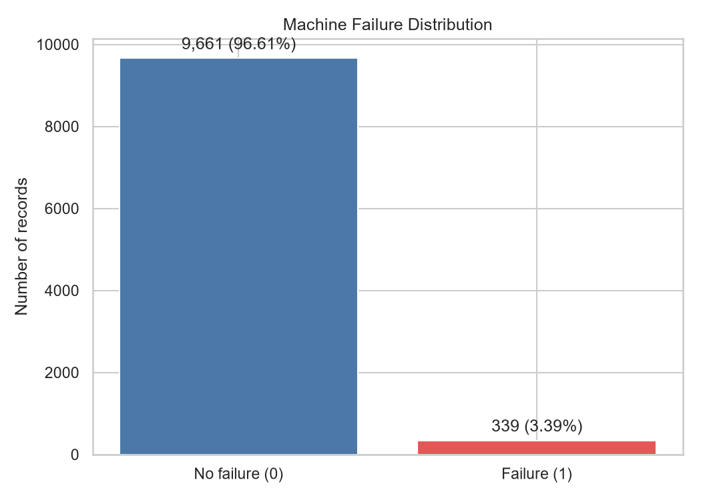
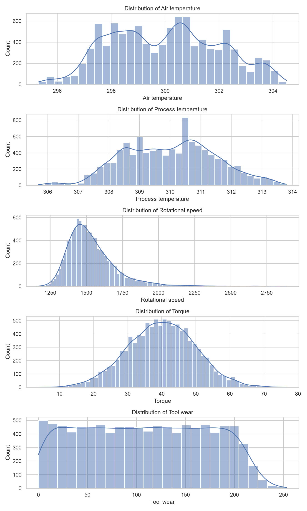
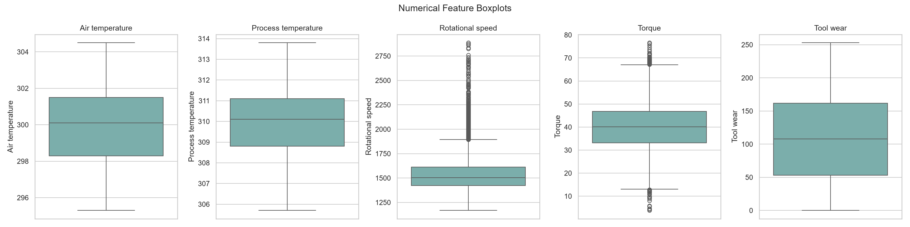
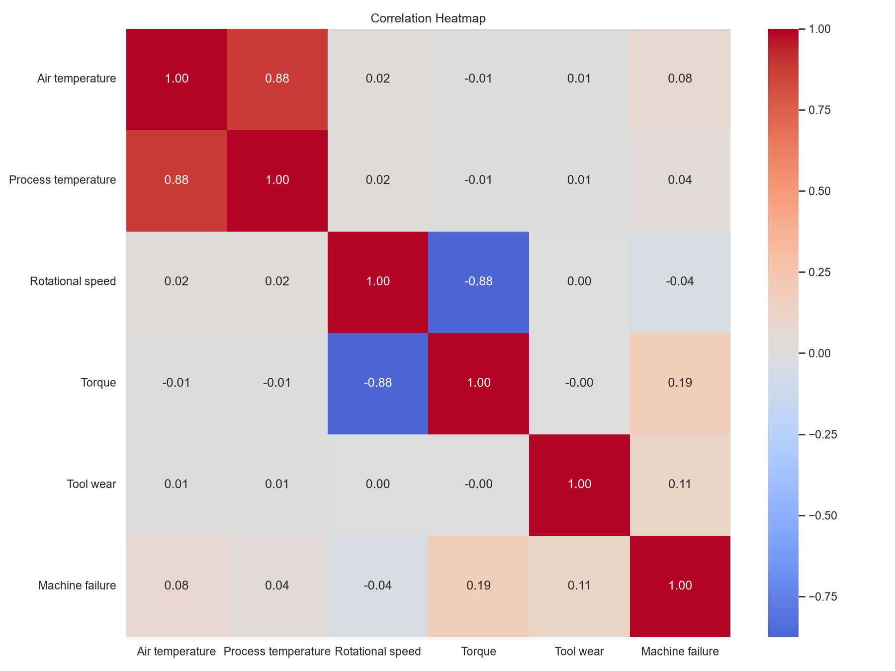
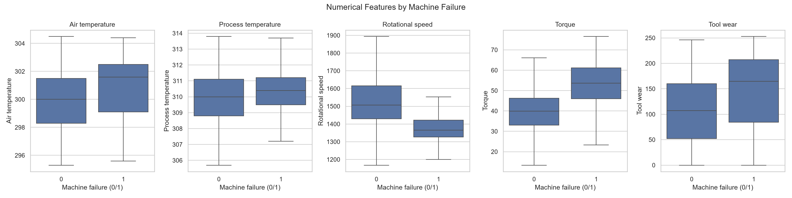
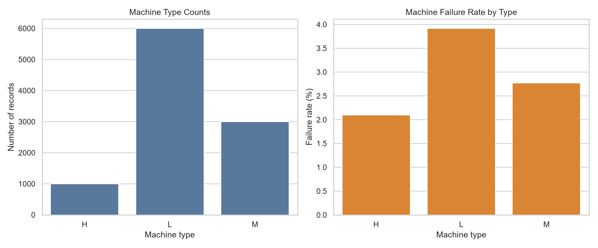
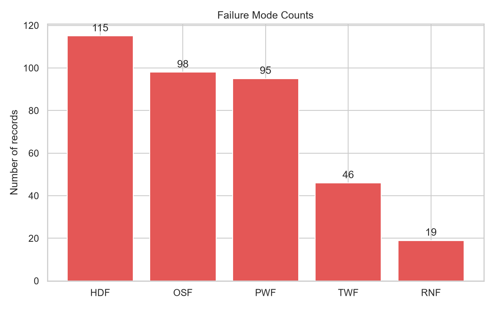

# AI4I 2020 Exploratory Data Analysis

## Key findings

- 339 of 10,000 records show machine failure (3.39%); the non-failure to failure ratio is 28.5:1.
- **Torque** has the largest absolute Pearson correlation with machine failure (r=0.191); this is an association, not causation.
- **Rotational speed** has the most IQR outliers (418).
- **HDF** is the most frequently flagged failure mode (115 records).
- Type **L** has the highest observed failure rate (3.92%).

## Dataset overview

- **Shape:** 10,000 rows x 12 columns
- **Columns:** Type, Air temperature, Process temperature, Rotational speed, Torque, Tool wear, Machine failure, TWF, HDF, PWF, OSF, RNF

### Data types

```text
Type                       str
Air temperature        float64
Process temperature    float64
Rotational speed         int64
Torque                 float64
Tool wear                int64
Machine failure          int64
TWF                      int64
HDF                      int64
PWF                      int64
OSF                      int64
RNF                      int64
```

### Sample records (first five rows)

```text
Type  Air temperature  Process temperature  Rotational speed  Torque  Tool wear  Machine failure  TWF  HDF  PWF  OSF  RNF
   M            298.1                308.6              1551    42.8          0                0    0    0    0    0    0
   L            298.2                308.7              1408    46.3          3                0    0    0    0    0    0
   L            298.1                308.5              1498    49.4          5                0    0    0    0    0    0
   L            298.2                308.6              1433    39.5          7                0    0    0    0    0    0
   L            298.2                308.7              1408    40.0          9                0    0    0    0    0    0
```

## Data quality and descriptive statistics

- **Missing values:** 0 total
- **Missing values by column:**
```text
No missing values.
```
- **Exact duplicate rows:** 0

### Descriptive statistics for numerical features

```text
                       count     mean     std     min     25%     50%     75%     max
Air temperature      10000.0   300.00    2.00   295.3   298.3   300.1   301.5   304.5
Process temperature  10000.0   310.01    1.48   305.7   308.8   310.1   311.1   313.8
Rotational speed     10000.0  1538.78  179.28  1168.0  1423.0  1503.0  1612.0  2886.0
Torque               10000.0    39.99    9.97     3.8    33.2    40.1    46.8    76.6
Tool wear            10000.0   107.95   63.65     0.0    53.0   108.0   162.0   253.0
```

### IQR outlier counts

Values outside 1.5 x IQR bounds are flagged for exploration; they are not removed.

```text
                     Lower IQR bound  Upper IQR bound  Outlier count  Outlier percent
Air temperature               293.50           306.30              0             0.00
Process temperature           305.35           314.55              0             0.00
Rotational speed             1139.50          1895.50            418             4.18
Torque                         12.80            67.20             69             0.69
Tool wear                    -110.50           325.50              0             0.00
```

## Machine failure target

```text
                 Count  Percent
Machine failure                
0                 9661    96.61
1                  339     3.39
```
- **Failure rate:** 3.39%
- **Non-failure to failure ratio:** 28.5:1
- The target is imbalanced, so accuracy alone may not describe future model performance well.



## Numerical features and relationships

### Correlation with machine failure

Pearson correlations are descriptive associations, not evidence of causation.

```text
Torque                 0.191
Tool wear              0.105
Air temperature        0.083
Rotational speed      -0.044
Process temperature    0.036
```









## Machine type

Failure counts and rates by machine type:

```text
      failures  records  failure_rate
Type                                 
H           21     1003          2.09
L          235     6000          3.92
M           83     2997          2.77
```



## Failure modes

Mode flags can overlap, so their counts do not necessarily add up to the number of failed machines.

```text
     Records with mode  Percent of all records  Failed records with mode  Percent of failures with mode
TWF                 46                    0.46                        46                          13.57
HDF                115                    1.15                       115                          33.92
PWF                 95                    0.95                        95                          28.02
OSF                 98                    0.98                        98                          28.91
RNF                 19                    0.19                         1                           0.29
```



## Scope

This phase is exploratory only. The raw CSV was read without modification; no preprocessing, feature engineering, or model training was performed.
